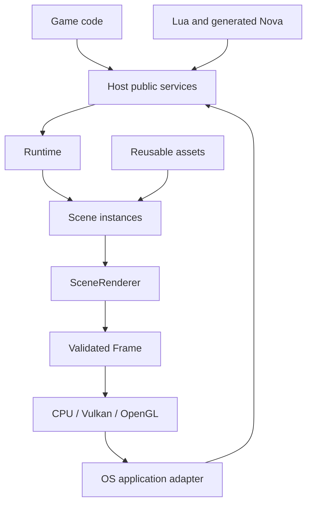

# Retrato Engine, an AI Slop Vibe Coded Game Engine in C++, Lua, own language and more stuff.

**A small, modular C++17 engine for low-poly 3D games, 2.5D gameplay and real-time animation.**

[English](README.md) · [Español](README.es.md)

**Version 0.7.0 — initial development release.** Vulkan is the preferred GPU
backend; OpenGL and a software CPU renderer are available behind the same engine
API. C++ can implement the entire game. Lua 5.4 and **Nova**, the project's
C++-transpiled language, are optional and can share one runtime with native code.

The title is unserious. The capability and testing claims below are not.

## Contents

- [Purpose and scope](#purpose-and-scope)
- [Build and run](#build-and-run)
- [Integrating a game](#integrating-a-game)
- [Architecture and ownership](#architecture-and-ownership)
- [Rendering and graphics configuration](#rendering-and-graphics-configuration)
- [Assets and animation](#assets-and-animation)
- [Collision and physics](#collision-and-physics)
- [C++, Lua and Nova](#c-lua-and-nova)
- [Particles, projectiles and UI](#particles-projectiles-and-ui)
- [Saving, paths and packaging](#saving-paths-and-packaging)
- [Validation and hardware results](#validation-and-hardware-results)
- [Platform support](#platform-support)
- [AI-assisted development](#ai-assisted-development)
- [Privacy, security and licensing](#privacy-security-and-licensing)

## Purpose and scope

Retrato targets deliberately modest geometry, stylized lighting and explicit
resource budgets. Suitable uses include low-poly 3D games, 2D gameplay in a 3D
scene, retro presentation, and real-time animated scenes.

It provides reusable rendering, animation, collision, input, events and
persistence services. It is a library-first engine: game rules and product
structure belong to the application. It does not impose a visual editor, ECS,
network service, account system or mandatory scripting language.

| Area | Available now | Boundary |
|---|---|---|
| Rendering | Vulkan, OpenGL 3.3, CPU; normal/PS1/N64/pixel; CRT | Simplified materials; CPU scene preparation and shadow generation |
| Desktop presentation | Direct GPU presentation in the application adapter | Offscreen factories retain explicit readback; Android still uses a copy path |
| Assets | OBJ/MTL, FBX, glTF/GLB, cooked `.embasset` | Not every extension or authoring-tool feature |
| Animation | Skeletons, linear skinning, named TRS clips, attachments | No general IK, retargeter or animation graph |
| Collision | Mesh BVH, raycasts, sphere/AABB sweeps, arcade sliding | Queries are not a general rigid-body solver |
| Advanced physics | Optional Jolt behind engine types and handles | Must be selected at build time and runtime |
| Gameplay | Managed entities, input, events, signals, fixed updates | Application-defined rules |
| Effects | Optional generic particle/VFX module, projectile pool | No GPU particle simulation or bloom |
| UI | Optional retained RmlUi interface | CPU painter; not a web browser |
| Persistence | Typed, validated binary game-state container | Not automatic serialization of arbitrary C++ objects |
| Languages | C++, Lua 5.4, Nova 0.2 | Cross-language functions require explicit bindings |

**Not implemented:** integrated audio, actual world streaming, automatic convex
mesh decomposition, a complete editor, networking, general hot reload, Android
Vulkan swapchain presentation, or automatic GPU composition of retained UI.
These are limits, not features activated by adding a TOML setting.

## Build and run

### Requirements

- A C and C++17 toolchain.
- CMake 3.20 or newer; **3.21 or newer for presets**.
- A build tool such as Make, Ninja or Visual Studio.
- Optional dependencies only for the selected modules.

The CPU preset requires no SDL, GPU SDK, Lua, FreeType or Jolt installation.
Small importers are included in the source tree. CMake does not download missing
dependencies. Do not run the application with `sudo`.

### Dependency-free baseline

From the repository root:

```sh
cmake --preset cpu
cmake --build --preset cpu --parallel 2
ctest --preset cpu
```

This builds the CPU engine, bundled importers, tools, Nova and validation targets.
For only the runtime library and cooked assets:

```sh
cmake --preset runtime
cmake --build --preset runtime --parallel 2
```

### Linux window with Vulkan

Install SDL2 development files and Vulkan headers/loader/drivers through your
system package manager. Python 3 is used by convenience and SDK-verification
tools, not by the game runtime.

```sh
cmake --preset linux-x64 -DEMBER_STARTER=ON
cmake --build --preset linux-x64 --parallel 2
ctest --preset linux-x64
./build/linux-x64/templates/game/retrato_game --backend vulkan
```

To remove the application's render-rate cap:

```sh
./build/linux-x64/templates/game/retrato_game --backend vulkan --uncapped
```

Simulation remains fixed-step. A compositor, driver or presentation mode may
still limit displayed frames. More rendered frames do not accelerate gameplay.
`--headless --frames 120` runs simulation without opening a window; it is not a
GPU rendering benchmark.

To add OpenGL as a fallback:

```sh
cmake --preset linux-x64-compat -DEMBER_STARTER=ON
cmake --build --preset linux-x64-compat --parallel 2
./build/linux-x64-compat/templates/game/retrato_game --backend auto
```

`auto` tries Vulkan, then compiled OpenGL, then CPU. A specifically requested
backend reports failure instead of silently selecting another one. Check CMake's
warnings: requesting an optional backend is not proof its dependencies were found.

### Optional modules

| CMake option | Effect / dependency |
|---|---|
| `EMBER_VULKAN` | Vulkan headers; loader/driver at runtime |
| `EMBER_OPENGL` | Desktop OpenGL 3.3 and SDL2; **not OpenGL ES** |
| `EMBER_APP` | SDL2 desktop adapter or Android NativeActivity |
| `EMBER_VIEWER` | Legacy SDL tooling windows |
| `EMBER_IMPORTERS` | Bundled OBJ/FBX/glTF and image readers; OFF keeps cooked assets |
| `EMBER_LUA` | Lua 5.4 development installation; omitted with warning if unusable |
| `EMBER_NOVA` | Development-time Nova compiler and native support |
| `EMBER_VFX` | Separate effects library; no new external dependency |
| `EMBER_RMLUI` | Included RmlUi source plus SDL2 and FreeType |
| `EMBER_JOLT` | Installed Jolt or local `EMBER_JOLT_SOURCE`; never downloaded automatically |
| `EMBER_TOOLS` | Import, cooking and rendering tools |
| `EMBER_EXAMPLES` | Optional executable validation applications |
| `EMBER_TESTS` | Automated tests |

`desktop` enables additional integrations, including UI dependencies. For a small
product, start from the required modules rather than enabling everything.
Omitting a library does not remove calls to it from your own application: guard
optional code or stop linking the corresponding target.

## Integrating a game

The public include path and namespace remain `ember/` and `ember` for source
continuity. Public CMake targets are `retrato::engine`, `retrato::app`,
`retrato::vfx` and, for source builds, `retrato::ui` when enabled.

### Source integration

A minimal consumer CMake project:

```cmake
cmake_minimum_required(VERSION 3.21)
project(MyGame LANGUAGES C CXX)
set(EMBER_APP ON CACHE BOOL "" FORCE)
set(EMBER_VIEWER OFF CACHE BOOL "" FORCE)
set(EMBER_TOOLS OFF CACHE BOOL "" FORCE)
set(EMBER_EXAMPLES OFF CACHE BOOL "" FORCE)
set(EMBER_TESTS OFF CACHE BOOL "" FORCE)
set(EMBER_LUA OFF CACHE BOOL "" FORCE)
set(EMBER_NOVA OFF CACHE BOOL "" FORCE)
set(EMBER_RMLUI OFF CACHE BOOL "" FORCE)
add_subdirectory(external/Retrato-Engine engine-build)
retrato_add_game(my_game SOURCES main.cpp)
```

Place the engine source in `external/Retrato-Engine`, or change that path to its
actual location. `main.cpp` implements the portable entry contract:

```cpp
#include <ember/application.hpp>

int retrato_game_main(int, char**) {
    ember::app::Options options;
    options.name = "MyGame";
    options.graphics.backend = "auto";

    ember::game::Entity actor;
    ember::app::Callbacks callbacks;
    callbacks.start = [&](ember::game::Host& host, const ember::platform::Paths&) {
        actor = host.create_box("actor", {1, 1, 1}, {.8f, .3f, .1f});
        host.set_camera({3, 2, -5}, {0, 0, 0});
    };
    callbacks.update = [&](ember::game::Host& host, float delta) {
        auto transform = host.transform(actor);
        transform.yaw += delta;
        host.set_transform(actor, transform);
    };
    return ember::app::run(options, callbacks);
}
```

The adapter owns the OS entry point. Do not add another `main()` to this target.
If your application owns its own window/loop, link `retrato::engine` directly and
use `Runtime`, `SceneRenderer` and `Backend` instead of `ember_app`.

### Installed SDK

```sh
cmake --install build/linux-x64 --prefix /actual/path/to/sdk
```

A consumer uses `find_package(Retrato 0.7 CONFIG REQUIRED)` with
`CMAKE_PREFIX_PATH` pointing to that SDK, then `retrato_add_game` as above.
SDK metadata checks the operating system and architecture. An x86 Linux library
is not an ARM or Windows SDK. Compiler/runtime compatibility also matters.

`templates/game` supports `RETRATO_SOURCE_DIR`, `GAME_USE_NOVA` and
`GAME_USE_LUA`. The selected engine must contain the requested modules.
The SDK does not currently export `retrato::ui`; integrate that module from source.

## Architecture and ownership



Assets are reusable resources. Scene objects are placed instances. Frame is the
prepared representation a renderer consumes. These roles are not interchangeable.

| Component | Ownership / lifetime |
|---|---|
| `Asset` | Mesh data, hierarchy, materials and animation clips |
| `Object` | Instance mesh, position/yaw, optional Animator; shared immutable materials/images |
| `Scene` | Objects and lights, not a GPU device |
| `Runtime` | Scene, camera, events, colliders and optional physics; coordinates animation/attachments |
| `game::Host` | Shared session, typed opaque handles and gameplay services; copies share the world |
| `SceneRenderer` | Temporary prepared data and retained texture/shadow storage |
| `Backend` | Device resources and captured pixels; no retained Scene pointers |
| Application adapter | Window, input, pause and pacing; outlives its backend |

`ObjectRef` combines a slot and identity. `add_object`/`destroy_object` reuse
released slots; stale references cannot silently target a replacement. `Entity`,
`AssetHandle`, `ColliderRef` and `BodyRef` have validated access paths.

Prefer managed creation/destruction. Direct `scene.objects.push_back` is append-only
and bypasses slot reuse; writing `active=false` does not release a managed slot.
Use `visible=false` to hide without destroying. References to vector elements may
be invalidated by insertion/reordering: keep handles, not long-lived element pointers.

Scene capacity and iteration retain the historical peak slot count; there is no
automatic scene compaction. Asset caches use explicit/weak ownership. Unloading a
cached asset does not invalidate instances that still own required resources.

A session is mutated from one simulation thread. CPU raster workers and optional
physics workers are internal. Do not mutate a scene while preparing/drawing it.
Store RAII `Connection`/`EventConnection` values for the period you need callbacks.
Dropping a connection disconnects it. Arbitrary callback exceptions have no rollback.

## Rendering and graphics configuration

### Common API

```text
Scene + Camera + Config -> SceneRenderer::prepare -> Frame -> Backend::draw
                                                          -> present / readback
```

`Backend::present()` returns true when its native surface handles presentation,
including a minimized-frame skip. Offscreen backends and CPU return false; the
platform adapter then displays `readback()`. Capture is explicit and available
for all backends. Captured RGBA pixels have a top-left origin and remain owned
by the backend; later operations may invalidate the returned reference.

The public gameplay API exposes no SDL, Vulkan or OpenGL objects. This is an
engine rendering abstraction, not a wrapper for every command of those APIs.
`DrawVertex` is 100 bytes and `ShaderSettings` is 96 bytes; sizes/offsets and
scalar assumptions are enforced with static assertions and shared attribute data.
Frame validation rejects invalid dimensions, non-finite data and invalid references.

Desktop Vulkan uses an UNORM RGBA/BGRA swapchain and GPU blit; OpenGL uses a
framebuffer blit and swap. Vulkan supports separate graphics/present queues and
per-swapchain-image completion semaphores, with one graphics submission in flight.
Capture storage is allocated only when readback is requested. CPU draws to memory
and the adapter presents an SDL texture. No dedicated GPU is required for CPU mode.

### Configuration

The default settings file is `config/engine.toml`; a product using the application
layout normally puts its own file at `content/engine.toml`. The library reads the
file the application supplies; it does not search unrelated installed versions.

```toml
[graphics]
backend = "auto"
profile = "pixel" # normal, ps1, n64, pixel
filter = "normal" # normal, crt
resolution_quality = 35
lighting_quality = 35
shadow_distance = 32
shadow_quality = 20
toon_bands = 4
local_lights_per_object = 2
shadowed_lights = 1
pixel_upscale = true
ps1_depth_test = false

[collision_cooking]
quality = 70
static_shape = "mesh_bvh"
dynamic_shape = "convex_compound" # reserved; no automatic decomposition

[physics]
backend = "none" # jolt requires EMBER_JOLT=ON
plane = "3d" # 3d, xy, xz, yz
solver_quality = 40
fixed_hz = 60
continuous_collision = "selected"

[runtime]
worker_threads = -1
streaming = false # reserved; true would not activate world streaming
```

The parser accepts the engine's strict key/value subset, not arbitrary TOML.
Unknown/duplicate keys and out-of-range values are rejected. Public C++ Config
construction is validated too. Optional omitted keys retain defaults.

| Setting | Implemented behavior |
|---|---|
| `resolution_quality` 1–100 | Width `160 + 16*floor((q-1)*800/(99*16))`, height width*9/16; 35 = 432×243, 100 = 960×540 |
| `shadow_quality` 1–100 | Shadow map 128² for 1–33, 256² for 34–66, 512² for 67–100 |
| `lighting_quality` 1–100 | Pixel-profile shadow grid: 2–32 cells per world unit |
| `shadow_distance` 4–128 | Width of the solar shadow region, following camera target |
| `toon_bands` 2–16 | Directional-light bands in the pixel profile |
| `local_lights_per_object` 0–4 | Budget of selected local lights per object |
| `shadowed_lights` 0–1 | Solar shadow off/on; not multiple local shadow maps |
| `pixel_upscale` | Application adapter: nearest when true, linear when false |
| `ps1_depth_test` | Optional Z occlusion while retaining PS1 visual treatment |
| `collision_cooking.quality` 1–100 | BVH leaf organization, 2–16 triangles; geometry retained |
| `physics.fixed_hz` 15–240 | Fixed simulation updates per second |
| `runtime.worker_threads` | 0: no raster workers; -1: automatic, up to 3 additional; 1–64: explicit |

Optional Jolt budgets: `max_bodies` 64–1,000,000, `max_body_pairs`
64–4,000,000, `max_contacts` 64–1,000,000 and `temporary_mb` 1–1024.
`gravity_x/y/z` set Jolt world gravity; default is `(0,-9.81,0)`.

Image resolution, shadow-map resolution and artistic shadow-cell density are
separate controls. Lower precision is a look and a budget choice, not free FPS.

### Profiles and PS1 behavior

- **Normal:** perspective, depth and continuous color.
- **PS1:** snapped vertices, affine UVs, 5-bit color, dithering and painter sorting.
- **N64:** perspective/depth, three-sample texture filtering and fog.
- **Pixel:** toon bands and a world-aligned shadow grid.
- **CRT filter:** scanlines and RGB mask; independent of profile. No bloom,
  persistence, curved tube or full analog-signal simulation.

Classic PS1 sorts triangles by average depth. Intersections and large triangles
can overlap incorrectly. `ps1_depth_test=true` enables stable Z occlusion while
retaining the other effects. Default false preserves classic rendering. The
profile is an artistic approximation, not full console emulation.

Low-level Frame supports `DepthMode::Automatic`, `Enabled` and `Disabled`, with
consistent CPU/OpenGL/Vulkan interpretation. GPU screenshots may differ slightly
at triangle edges due to rasterization rules.

Vertex transforms, animation, light selection and solar shadow construction run
on CPU. The selected backend rasterizes. There are no PBR materials, ray tracing,
local-light shadow maps, general sorted transparency or hardware instancing.

## Assets and animation

| Format | Geometry/materials | Rigging and clips |
|---|---|---|
| OBJ + MTL | Triangulation, UV/normals, base color and texture | No skeletal animation in the format |
| FBX ASCII/binary | Hierarchy, units converted to meters, Y-up, supported textures/materials | Linear skinning; curves baked to TRS tracks |
| glTF 2.0 / GLB | Main scene, triangle primitives, base/vertex color, texture, unlit and UV transform | Four skinning influences; STEP/LINEAR/CUBICSPLINE TRS |
| `.embasset` | Engine-cooked resource with geometry/materials/images/hierarchy | Skeleton and clips included |

Model textures support PNG/JPEG/BMP/TGA through the optional import module.
glTF textures may be external, base64 data or embedded in GLB. Authoring cameras
and lights do not automatically create gameplay cameras/lights.

Default import budgets per resource: 100,000 expanded vertices and 100,000
triangles, 2,048 nodes, textures up to 2,048² and 64 MiB total RGBA image data.
These are safety budgets, not content targets or performance guarantees.

```sh
./build/cpu/ember_import character.glb --out character.embasset
./build/cpu/ember_demo --backend cpu --model character.embasset \
  --clip Walk --time 0.3 --out character.ppm
```

Use an actual clip name from the imported asset. A PPM is an exported image, not
an interactive window. `EMBER_IMPORTERS=OFF` removes authoring readers from the
product; convert assets beforehand. Renaming an FBX file is not conversion.

Cooked files use explicit little-endian serialization and validate versions,
sizes, hierarchy, indices and finite values. Their format is versioned, not a
promise of permanent compatibility with every future engine release.

Bake authoring constraints/IK to bone motion before export. Runtime skinning is
linear with up to four influences. Morph targets, cloth, modifiers, runtime IK,
Draco/meshopt/Basis decoding and advanced PBR extensions are not integrated.
BLEND transparency is approximated by alpha cutout; this is not sorted glass.
Attachments reference named bones; collision cooked from an animated mesh is a
snapshot and does not follow skinning deformation.

## Collision and physics

The lightweight path offers compact CollisionMesh data, BVH/raycast and
continuous sphere/AABB sweeps with sliding. Static collision is cooked from
geometry without retaining UV/material/texture data. Editing or deforming the
source mesh afterwards does not update the cooked collider.

Host box queries use axis-aligned boxes, masks and a linear scan. They do not
inherit yaw or bone attachments. Sphere/box sweeps are conservative at corners.
Changing BVH leaf quality changes organization/query cost, not surface accuracy.
There is no universal “100% physics precision” setting.

Advanced physics is opt-in twice:

1. Build with `EMBER_JOLT=ON`, using an installed Jolt package or local source.
2. Set `physics.backend="jolt"` and explicitly create the required bodies.

C++ engine types expose box/sphere/capsule shapes, static/kinematic/dynamic motion,
forces, impulses, velocity, material parameters and selected CCD. Jolt remains
behind handles/PIMPL; its headers do not leak into gameplay APIs. No Jolt is
required for rendering, animation or arcade queries.

`physics.plane="xy"`, `"xz"` or `"yz"` restricts rigid-body degrees of freedom
for 2.5D gameplay. `"3d"` keeps three dimensions. Rendering remains 3D.
`solver_quality` controls bounded solver iterations, not geometric detail.

Not exposed yet: general contact/trigger callbacks, Jolt-world raycasts, joints,
mesh cooking into Jolt or automatic compound-convex decomposition. Jolt execution
is not promised bit-identical across platforms.

## C++, Lua and Nova

### C++ services

`game::Host` provides typed entities/assets, transforms, camera/lights, input,
time, fixed updates, signals, collision queries and optional physics. Host can
own a new world or share a `std::shared_ptr<Runtime>` with native services.

```cpp
auto connection = host.on_update([&](float dt) {
    auto p = host.position(actor);
    p.x += 2.0f * dt;
    host.set_position(actor, p);
}); // retain connection while the callback should remain registered
```

Use `host.alive` before accessing potentially destroyed entities. Destruction
invalidates old handles. `host.unload_asset` releases its cache ownership;
existing instances retain what they need. `prune_destroyed` cleans Host records
after external native scene mutations.

### Lua 5.4

```lua
local actor
function start()
    actor = engine.box(0, 1, 0, 1, 1, 1, 0.8, 0.3, 0.1)
end
function update(time, code)
    engine.rotation(actor, time)
end
```

`Host::load_script(path)` owns the script and its event subscription. Direct
`Script` use requires forwarding Runtime events and respecting its borrowed
Runtime lifetime. Lua `update` receives `(time, code)`, **not Nova's delta**.

Available callbacks include start/update/cue, key down/up, mouse movement/buttons/
wheel and gamepad buttons/axes. Native UI callbacks can forward application
signals; there is no automatic DOM-to-Lua event bridge.

Lua opens standard libraries. Only load trusted scripts; it is not a mod sandbox.

### Nova 0.2

```text
var speed: float = 2.0

func update(delta: float) {
    transform.position.x += speed * delta
}
```

```text
.nova -> lexer -> parser -> AST -> semantic checks -> generated C++17 -> native compiler
```

Nova supports `int`, `float`, `bool`, `string`, `Vec2`, `Vec3` and engine value
handles; typed variables/functions, scopes, if/else, while, return, local imports,
fixed-size arrays, arithmetic/logic and compound assignment. Braces are used;
indentation is not syntax. No general classes, generics, inheritance, GC or JIT.

```text
func double(value: int) -> int { return value * 2 }
var health: int = 100
if health <= 0 { print("dead") }
```

```sh
./build/cpu/nova/nova --emit-cpp gameplay.nova -o gameplay.generated.cpp
```

`nova_add_module(logic gameplay.nova)` integrates generation/import dependencies
into CMake. Include the generated module in C++, construct its Program with Host
and the controlled Entity, and keep it alive while its callbacks should run.
The compiler module protocol is 2. Cross-compilation needs a host-runnable compiler
via `NOVA_HOST_COMPILER`, not an ARM executable run on an x86 build host.

`self` is the controlled entity; `transform.position` and `transform.yaw` are its
callback state. Common builtins cover entity creation/destruction, assets,
transforms, input, time/delta, integer signals, saving, camera/lights, clips,
arcade queries and a small optional-physics subset.

Diagnostics retain file/line/column and generated C++ `#line` mappings. Integer
arithmetic, division and execution budgets have checks. Native bindings/toolchain
failures can still produce C++ diagnostics. `float` uses double for scalar Nova
values; vectors use float32. No cross-platform bit-identical execution guarantee.

C++, Nova and Lua can run in the same world. They do not automatically call every
function in each other: use explicit C++ bindings or signals. No graphical debugger,
package manager or complex hot reload is included. Detailed syntax remains in
[the Nova reference](docs/NOVA_SPEC.md) (Spanish supplemental reference).

## Particles, projectiles and UI

### Effects module

`retrato::vfx` is optional. Pools contain bounded particle data; systems handle
emission and configurable forces/collision; separate visuals batch geometry into
scene objects. No game genre, damage rules or world plane is imposed.

Features include bursts, sustained/trail emission, editable dust/debris recipes,
arbitrary planes, force volumes, drag, continuous sweeps, bounce/friction,
settling and transient mesh effects. Applications choose when and where to emit.

The header-only particle pool can be used without rendering. Batched visuals
inherit engine lighting and profile behavior. Effects remain opaque: no additive
blend, soft particles, bloom, GPU simulation or universal Lua/Nova VFX binding.
Expose application-specific typed bindings when needed.

### Projectiles

`ember/projectiles.hpp` is a bounded, data-only pool with lifetime, velocity,
radius, monotonic IDs and user payload. A borrowed collision callback returns
the nearest contact; the application handles damage, teams, rendering and impacts.
Continuous sweeps include the final partial lifetime step. Pool mutation from
inside its own query callback is rejected; arbitrary exceptions have no rollback.

### Retained interface

RmlUi provides RML/RCSS layout with a small CPU painter and `UiOverlay` API.
There is no Chromium, Gecko, JavaScript runtime or browser network stack.
RML/RCSS are not full browser HTML/CSS.

The overlay caches its image until invalidated. Text, markup, visibility and
click callbacks are available. Input, animation or document changes may trigger
work; there is no universal zero-RAM/zero-CPU claim. One overlay may be alive at
a time because RmlUi uses global interfaces. UI image loading currently supports
BMP separately from model-image importers.

The generic application does not automatically composite this CPU UI over direct
GPU presentation. A custom composition adapter may require readback.

## Saving, paths and packaging

`SaveData` stores typed `int64`, `double`, `bool`, `string`, `Vec2` and `Vec3`
values. Binary files are versioned, little-endian and validated on load.
The game decides which values to save; arbitrary scene/C++ state is not serialized.

`platform::paths(organization, application, content_override)` separates read-only
content from writable per-user saves/cache. Relative resource names reject `..`.
Android assets are materialized from the APK into cache for existing file readers.
Convert filesystem paths to UTF-8 strings for APIs taking `std::string`.
The engine does not require a particular current working directory.

`retrato_add_game(... CONTENT_DIR ...)` refreshes content beside desktop binaries,
including asset-only changes. Windows entry arguments support Unicode.

```sh
python3 tools/package_source.py dist/Retrato-Engine-v0.7.0.zip
python3 tools/package_game.py build/my_game dist/my_game.zip --content content
```

The source packer excludes builds, private notes, caches, nested archives and PDFs;
`.obj` model files are intentionally retained. Product packages may need selected
runtime libraries and their licenses. Do not distribute the development compiler
or a whole build tree as the player's game. Build Linux binaries against the
oldest libc baseline you intend to support; compiling on a newer distribution
does not guarantee older-system binary compatibility.

## Validation and hardware results

### Current 0.7.0 validation — Linux x86-64

These are local checks performed before publication, **not a claim that GitHub
Actions already passed**. Toolchain: GCC 14, CMake 3.28, SDL2, Lua 5.4 and a virtual
X11 display. OpenGL used software Mesa; Vulkan used lavapipe/Mesa 25.0.7.

| Check | Result / scope |
|---|---|
| Desktop Release | **37/37** CTest; CPU, importers, Lua, Nova, VFX and application |
| Minimal runtime | **6/6**; no GPU/SDL/importers/Lua/Nova/VFX/tools |
| ASan + UBSan + float-cast-overflow | **25/25**; CPU application, Lua/Nova/VFX; no GPU/import modules in this sanitizer build |
| OpenGL versus CPU | **5/5** selected comparisons, including depth contract |
| Vulkan versus CPU | **5/5** selected comparisons, including depth contract |
| Native GPU presentation | Draw/present/capture across 8 iterations plus window/framebuffer resize, both backends |
| Installed SDK | Independent C++/Nova/Lua consumer after relocation; Unicode/spaces, content refresh and wrong-target rejection |
| Visual regression | Normal, classic PS1, N64 and pixel output byte-identical to 0.6.1 in the CPU regression scene |
| SDL CMake integration | Raw imported target, child alias and inherited target visibility |

LeakSanitizer was disabled (`detect_leaks=0`) because the test environment cannot
perform its required process inspection. No Vulkan validation layers were run.
RmlUi and Jolt were not exercised in this matrix. Software-driver correctness
does not establish physical GPU performance. Raster edge comparisons use tolerances;
the byte-identical claim above applies only to the stated CPU regression.

To reproduce backend checks after building `desktop` with `EMBER_APP=ON`:

```sh
./build/desktop/ember_presentation_tests opengl
./build/desktop/ember_presentation_tests vulkan
EMBER_TEST_BACKEND=opengl ctest --test-dir build/desktop --output-on-failure \
  -R '^(ember_tests|ember_asset_tests|ember_vfx_tests|ember_vfx_context_tests|ember_render_contract_tests)$'
EMBER_TEST_BACKEND=vulkan ctest --test-dir build/desktop --output-on-failure \
  -R '^(ember_tests|ember_asset_tests|ember_vfx_tests|ember_vfx_context_tests|ember_render_contract_tests)$'
```

### Historical low-end test — Sony VAIO VPCYB35AL

| Item | Reported hardware / software |
|---|---|
| CPU | AMD E-450, 2 cores / 2 threads, 1.65 GHz |
| GPU | Integrated Radeon HD 6320, shared memory |
| Architecture | x86-64 |
| System | Zorin OS 17.3 Lite, Ubuntu 22.04 base, GLIBC 2.35 |
| Display | 1366×768; internal render resolution was not recorded |
| Application | Earlier low-poly metroidvania test built with the Ember/Retrato lineage |
| Observed result | Approximately **15 stable FPS**, reported by the maintainer |

That result proves an earlier game/build ran on this hardware. It is **not a
benchmark of 0.7.0**, a 60-FPS claim, or evidence that 15 FPS is a playable target.
The precise revision, graphics backend/settings, RAM usage, frame-time distribution
and test duration were not captured. No improvement over that number is claimed
without rerunning a controlled test on the same machine. The potato booted;
that is a starting point, not a victory lap.

For new reports record the revision, build type, CPU/GPU, driver, OS, backend,
internal resolution, settings, worker count, scene, warm-up and sample duration.
Separate simulation/preparation/draw/readback/present costs. Display FPS alone
cannot locate a bottleneck.

## Platform support

| Target | Existing infrastructure | Release validation status |
|---|---|---|
| Linux x86-64 | Native paths, SDL input/presentation, CPU/Vulkan/GL, SDK | Locally checked as described above |
| Linux ARM64 | Common core, architecture/toolchain files | Not validated on ARM hardware here |
| Windows x64 / ARM64 | Unicode entry/paths, SDL, Vulkan loader, CMake configuration | CI definitions included; not locally built/run |
| Android ARM64 / x86-64 | NativeActivity, Gradle project, APK resource/cache paths | Not built or run on a device here |
| 32-bit ARM/x86 | Architecture detection/configuration | Not certified; no release binary provided |

Android's project uses minSdk 24. Vulkan support still depends on the device and
driver. The OpenGL backend is desktop GL, not Android GLES. Android presentation
still copies/readbacks to ANativeWindow; native Vulkan WSI remains future work.
There is one common core with per-OS adapters, not three divergent engine copies.
C++ source is recompiled for each target; binary libraries are platform/ABI-specific.

The repository includes CI jobs for these destinations. A workflow definition is
not evidence a job or device test succeeded. No stable cross-release C++ ABI,
all-hardware performance target or bug-free guarantee is made.

## AI-assisted development

The ceremonial model name is:

> ChatGPT Sonnet 6.1 Obliterated full uncensored Qwen 3 Deepseek R2 Kimi K4.5 GLM 7.2 Ultra Obliterated

**That is a joke, not a real model identifier, a benchmark or an endorsement.**

The project was developed with substantial AI assistance through ChatGPT/Codex,
with additional prototyping/review attributed by the maintainer to Claude Sonnet,
Muse Spark and DeepSeek. Exact model versions and line-by-line provenance were
not consistently recorded, so no invented provenance certificate is supplied.
AI assistance does not prove correctness: the tests, source, constraints and
known limitations are the evidence readers should evaluate.

## Privacy, security and licensing

The publication tree contains source, required assets, tests and licenses. It does
not contain development builds, machine logs, private notes, personal absolute
paths, environment dumps, PDFs, credentials or workstation telemetry files.
The engine has no built-in analytics client or automatic network reporting.
Runtime diagnostics and application-defined scripts are separate from telemetry;
Lua standard libraries can access files/processes and are not sandboxed.

Publication preparation used an isolated source copy. Upstream copyright/license
notices, including attribution contacts, are preserved. Public GitHub account and
commit metadata are governed separately by GitHub/account settings; source
cleanup does not anonymize an account.

Project code is MIT; see [LICENSE](LICENSE). Optional/bundled dependencies retain
their own licenses; see [THIRD_PARTY.md](THIRD_PARTY.md). Safety fixes in vendored
cgltf use alignment-safe scalar reads; ufbx uses its portable sanitizer-safe mode.
Use trusted content or additional process isolation for hostile inputs.

This README is the English technical entry point. [README.es.md](README.es.md)
is its Spanish companion. Additional API/syntax/module references live in
[docs/](docs) as Markdown; no PDF is required. Contribution guidelines are in
[CONTRIBUTING.md](CONTRIBUTING.md); current reporting limitations are in
[SECURITY.md](SECURITY.md).
